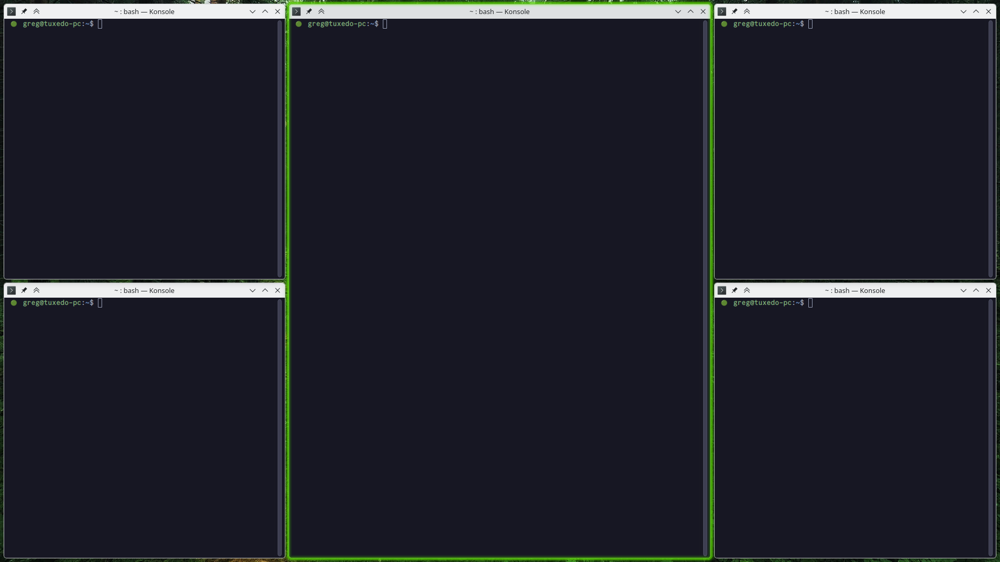

# KDE / KWin Active Window Outline

A native KWin effect for KDE Plasma 6 that draws a configurable, theme-independent outline around the active window.

The effect is useful with minimal window decorations and tiling layouts, where it can otherwise be difficult to see which window currently has keyboard focus. It works at compositor level instead of relying on the selected Plasma theme, Aurorae decoration, or application toolkit.

## Features




- Follows the active KWin window automatically.
- Uses the current Plasma accent color or a custom color.
- Configurable width, corner radius, and offset from the window edge.
- Can draw inside the window, keeping the outline visible on maximized and tiled windows.
- Optional edge smoothing for a cleaner outline at fractional display scales.
- Optional smooth, accent-colored glow with a configurable size.
- Works independently of Qt, GTK, client-side decorations, and the current window theme.
- Temporarily hides the outline while context menus, submenus, dropdowns,
  combo-box lists, or Plasma panel popups are visible.
- Provides a graphical configuration page in Desktop Effects.
- Shows the installed effect version in the configuration page.

## Compatibility

| Component | Status |
| --- | --- |
| KDE Plasma 6 / KWin 6 | Required |
| Wayland | Supported and tested |
| X11 | Build support included; currently not tested by the maintainers |
| Plasma 5 | Not supported |

Version 1.2.8 has been tested on Wayland with TUXEDO OS 24.04
(KWin 6.6.6), KDE neon User Edition, and KDE neon Testing Edition.

KWin effects are native plugins and use KWin's private binary interface. Rebuild and reinstall the effect after a major KWin update if it stops loading.

## Installation

### Guided Wayland installation

Clone the repository or download and extract the latest source release, then
run this command from the project directory:

```bash
bash install-active-window-outline.sh
```

The installer detects Debian/Ubuntu (`apt`), Fedora (`dnf`), Arch (`pacman`),
and openSUSE (`zypper`) families and installs their build dependencies. It then
compiles the effect against the KWin version installed on that computer,
installs its two plugin files, and enables it. This is a source build, not one
binary shared across distributions: KWin plugins must match the local KWin ABI.

For an overview without changing the system, run:

```bash
bash install-active-window-outline.sh --dry-run
```

On another distribution, or when the development dependencies are already
installed, run `bash install-active-window-outline.sh --skip-deps`. CMake will
report anything still missing. The guided installer currently targets Wayland;
X11 remains an experimental manual build.

The script uses `sudo` or `doas` only for package installation and copying the
compiled plugins into the system Qt plugin directory. Review the script before
running it if desired. Existing effect settings are preserved on update.

When updating an existing installation, log out and back in after the installer finishes. Qt may keep the previous native library loaded in KWin even after the file on disk has been replaced.

### Manual Wayland build

Install a C++ compiler, CMake, Extra CMake Modules, Qt 6 development files
(Core, DBus, Gui, Widgets, Quick, and the `qtplugininfo` tool), KF6
CoreAddons/ConfigWidgets/KCMUtils development files, Vulkan headers, libdrm
development files, and the development package matching your installed KWin
version. Then run:

```bash
cmake -S . -B build-wayland \
  -DKWIN_BACKEND=WAYLAND \
  -DCMAKE_BUILD_TYPE=Release
cmake --build build-wayland --parallel
sudo cmake --install build-wayland
```

Enable **Active Window Outline** in:

**System Settings → Window Management → Desktop Effects**

## Configuration

Open the gear button next to **Active Window Outline** in Desktop Effects.

| Setting | Default | Description |
| --- | ---: | --- |
| Use accent color | On | Follows the current Plasma accent color. |
| Accent opacity | 66% | Controls the outline and glow opacity when using the accent color. |
| Custom color | `#3daee9` | Used when accent-color tracking is disabled. |
| Border width | 2 px | Thickness of the outline. |
| Outline offset | 0 px | Distance between the window edge and the outline. |
| Border radius | 6 px | Corner radius of the outline. |
| Draw inside window | On | Draws the outline over the inside edge of the window. |
| Smooth edges | On | Adds a subtle antialiased feather to both outline edges. |
| Soft glow | On | Adds a subtle colored halo around the outline. |
| Glow size | 6 px | Controls how far the halo extends. |

### Inside and outside drawing

With **Draw inside window** enabled, the offset moves the outline farther into the window. This is the recommended mode for maximized and tiled windows.

With the option disabled, the offset moves the outline outside the window. The effect only draws pixels; it does not move windows or reserve layout space. An external outline can therefore be clipped at a screen edge or overlap a neighboring tiled window. Configure sufficient gaps in your tiling script if you use outside drawing.

## Updating

Pull or extract the new source, run the installer again, then log out and back in:

```bash
bash install-active-window-outline.sh
```

## Uninstallation

```bash
bash uninstall-active-window-outline.sh
```

The uninstaller disables the effect, removes its two plugin files, clears its KWin settings, and refreshes KDE. It does not remove build dependencies, themes, window rules, or the downloaded source directory.

## Troubleshooting

### The effect is installed but the outline does not appear

- Confirm that the effect is enabled in Desktop Effects.
- Log out and back in after an update.
- Test with **Draw inside window** enabled and an offset of 20 px.
- Make sure OpenGL compositing is active.

### Outside outlines disappear on maximized windows

This is expected: the outline is outside the screen bounds. Enable **Draw inside window**.

### Settings do not update immediately

Version 1.1.1 and later watch `kwinrc` and reload saved settings automatically. If an older native library is still loaded, log out and back in.

### Compilation fails on KDE neon

Use version 1.2.8 or later. Version 1.2.7 does not compile against the newer
KWin headers used by KDE neon User and Testing editions. Make sure the installed
`kwin-dev` package matches the KWin version running on your system, then rerun
the installer from the updated source directory.

## Contributing

Bug reports and pull requests are welcome. See [CONTRIBUTING.md](CONTRIBUTING.md) before submitting changes.

## Origin and license

The rendering foundation was adapted from [Powermayer/keep-above-outline](https://github.com/Powermayer/keep-above-outline) by Matthias Bauer. This project changes the behavior from tracking “Keep Above” windows to tracking KWin focus and adds screen-level rendering, inside/outside placement, offset handling, configuration reloads, and dedicated installation tooling.

See [NOTICE](NOTICE) for attribution details.

This project is licensed under **GPL-3.0-or-later**. See [LICENSE](LICENSE).
