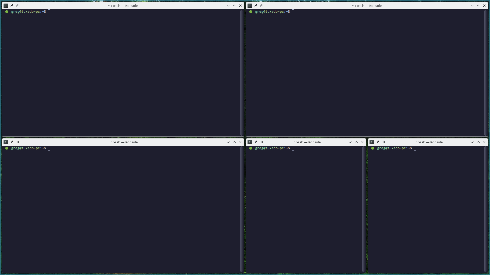
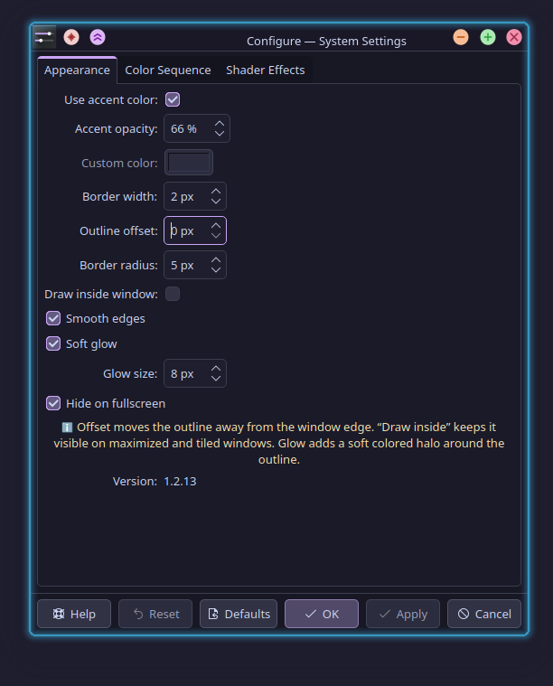
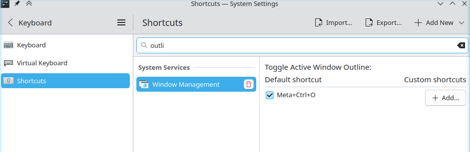

# KDE / KWin Active Window Outline

A native KWin effect for KDE Plasma 6 that draws a configurable, theme-independent outline around the active window.

The effect is useful with minimal window decorations and tiling layouts, where it can otherwise be difficult to see which window currently has keyboard focus. It works at compositor level instead of relying on the selected Plasma theme, Aurorae decoration, or application toolkit.

## Features

[kwin-active-window-outline.webm](https://github.com/user-attachments/assets/d1acd016-a399-44b8-931e-46944443d1f5)



- Follows the active KWin window automatically.
- Global shortcut (default: **Meta+Ctrl+O**) to quickly toggle the outline on or off.
- Uses the current Plasma accent color, a custom color, or an animated multi-color sequence.
- **Dynamic Multi-Color Cycling**: add any number of colors with custom hold durations per color, global transition time, sequential or random order, and CSS-style easing curves (Ease-in-out, Linear, Ease-in, Ease-out).
- **Modular Visual & Shader Effects** (can be mixed and matched together):
  - **Breathe / Pulse**: smooth cyclic brightness and alpha breathing with adjustable speed and depth.
  - **Futuristic Glitch**: sci-fi holographic scanline jitter and horizontal displacement bars.
  - **Neon Flicker**: realistic neon tube voltage-drop flickering.
  - **Flash / Strobe**: intermittent strobe burst effects with configurable intervals and flash duration.
- Highly optimized: animation timer only ticks when visual effects are enabled and repaints strictly the active window outline; zero background CPU/GPU overhead when static, minimized, or fullscreen.
- Option to automatically hide the outline when the active window is in fullscreen mode.
- Configurable width, corner radius, and offset from the window edge.
- Can draw inside the window, keeping the outline visible on maximized and tiled windows.
- Optional edge smoothing for a cleaner outline at fractional display scales.
- Optional smooth, accent-colored glow with a configurable size.
- Works independently of Qt, GTK, client-side decorations, and the current window theme.
- Temporarily hides the outline while context menus, submenus, dropdowns,
  combo-box lists, or Plasma panel popups are visible, including Firefox
  context menus and KWin's titlebar menu.
- Clips the outline around visible panels, using the animated panel background
  mask on Wayland when available to follow floating-panel transitions.
- Defers software cursor rendering on Wayland with KWin 6.6+ so the cursor is
  not obscured by the outline or glow.
- Provides a tabbed graphical configuration page in Desktop Effects.
- Shows the installed effect version in the configuration page.

## Compatibility

| Component | Status |
| --- | --- |
| KDE Plasma 6 / KWin 6 | Required |
| Wayland | Supported and tested |
| X11 | Build support included; currently not tested by the maintainers |
| Plasma 5 | Not supported |

The code shipped in 1.2.11 was built and tested on Wayland with KWin 6.6.6
(TUXEDO OS 24.04) and KWin 6.8 (CachyOS), verifying floating-panel clipping,
menu suppression, and software cursor rendering above the outline. Its
regression tests also pass; these logic tests do not replace visual testing
in a running Plasma session.

Earlier releases were tested on Wayland with the following systems. These are
historical results, not a claim that every new release has been retested on
every distribution:

| Distribution | Plasma | KWin | Base |
| --- | --- | --- | --- |
| TUXEDO OS 24.04 | — | 6.6.6 | — |
| CachyOS | 6.8.0 | 6.8.0 | Arch Linux |
| KDE neon User Edition | 6.8.0 | 6.8.0 | Ubuntu 24.04 (Noble) |
| KDE neon Testing Edition | 6.8.0 | 6.8.1 | Ubuntu 24.04 (Noble) |

Version 1.2.11 was also verified on CachyOS with KWin 6.8.0 (Wayland). It
includes a compatibility path for KWin 6.4.x, but that path has not yet been
tested on a KWin 6.4 system.

KWin effects are native plugins and use KWin's private binary interface.
Compatibility code for multiple KWin versions does not make one compiled
binary portable between those versions. A KWin update can require rebuilding
and reinstalling the effect even when the effect's source has not changed.

## Installation

This release is distributed as source code. Prebuilt `.deb`/`.rpm` packages
and an OBS update repository are not provided yet.

### Quick install & update (recommended)

Run this one-liner in your terminal to automatically download the latest release, compile against your running KWin version, and enable the effect (or update an existing installation):

```bash
curl -sSL https://raw.githubusercontent.com/gmalinowski/kwin-active-window-outline/main/install.sh | bash
```

The installer automatically detects the latest release from GitHub (`releases/latest`), installs any missing build dependencies for your distribution (Debian/Ubuntu, Fedora, Arch/CachyOS, openSUSE), and compiles the plugin for your local KWin ABI. Existing configuration settings are preserved on update.

To test the latest unreleased development build from the `main` branch instead, pass `--beta`:

```bash
curl -sSL https://raw.githubusercontent.com/gmalinowski/kwin-active-window-outline/main/install.sh | bash -s -- --beta
```

*(You can inspect the scripts before running: [`install.sh`](install.sh) or [`install-active-window-outline.sh`](install-active-window-outline.sh).)*

### Guided installation from local source

Clone the repository or download and extract a [source release](https://github.com/gmalinowski/kwin-active-window-outline/releases), then
run this command from the project directory:

```bash
bash install-active-window-outline.sh
```

The installer detects Debian/Ubuntu (`apt`), Fedora (`dnf`), Arch/CachyOS (`pacman`),
and openSUSE (`zypper`) families and installs their build dependencies. It then
compiles the effect against the KWin version installed on that computer,
installs its two plugin files, and enables it. This is a source build, not one
binary shared across distributions: KWin plugins must match the local KWin ABI.

For an overview without changing the system, run:

```bash
bash install-active-window-outline.sh --dry-run
```

On another distribution, or when the development dependencies are already
installed, run `bash install-active-window-outline.sh --skip-deps`. CMake will
report anything still missing. The guided installer currently targets Wayland;
X11 remains an experimental manual build.

The script uses `sudo` or `doas` only for package installation and copying the
compiled plugins into the system Qt plugin directory. Review the script before
running it if desired. Existing effect settings are preserved on update.

When updating an existing installation, log out and back in after the installer finishes. Qt may keep the previous native library loaded in KWin even after the file on disk has been replaced.

### Manual Wayland build

Install a C++ compiler, CMake, Extra CMake Modules, Qt 6 development files
(Core, DBus, Gui, Widgets, Quick, and the `qtplugininfo` tool), KF6
CoreAddons/ConfigWidgets/KCMUtils/GlobalAccel development files, Vulkan headers, libdrm
development files, and the development package matching your installed KWin
version. Then run:

```bash
cmake -S . -B build-wayland \
  -DKWIN_BACKEND=WAYLAND \
  -DCMAKE_BUILD_TYPE=Release
cmake --build build-wayland --parallel
sudo cmake --install build-wayland
```

Enable **Active Window Outline** in:

**System Settings → Window Management → Desktop Effects**

## Configuration

Open the gear button next to **Active Window Outline** in Desktop Effects.



### Tab 1: Appearance

| Setting | Default | Description |
| --- | ---: | --- |
| Use accent color | On | Follows the current Plasma accent color. |
| Accent opacity | 66% | Controls the outline and glow opacity when using the accent color. |
| Custom color | `#3daee9` | Used when accent-color tracking is disabled. |
| Border width | 2 px | Thickness of the outline. |
| Outline offset | 0 px | Distance between the window edge and the outline. |
| Border radius | 6 px | Corner radius of the outline. |
| Draw inside window | On | Draws the outline over the inside edge of the window. |
| Smooth edges | On | Adds a subtle antialiased feather to both outline edges. |
| Soft glow | On | Adds a subtle colored halo around the outline. |
| Glow size | 6 px | Controls how far the halo extends. |
| Hide on fullscreen | On | Automatically hides the outline and glow when the active window is fullscreen. |

### Tab 2: Color Sequence

Cycle through custom colors dynamically with animated transitions.

| Setting | Default | Description |
| --- | ---: | --- |
| Enable color cycling | Off | Activates the color sequence cycle. |
| Color table | 3 colors | Add, remove, or reorder any number of colors. Double-click to pick a color, and configure hold duration per color. |
| Transition duration | 2.0 s | Time taken to smoothly blend from one color stop to the next. |
| Transition easing | Ease in-out | CSS-style easing curve (`Ease in-out`, `Linear`, `Ease in`, `Ease out`). |
| Cycle order | Sequential | Sequence progression (`Sequential` or `Random`). |

### Tab 3: Shader Effects

Mix and match procedural effects to enhance the outline and glow.

| Effect | Settings | Default | Description |
| --- | --- | ---: | --- |
| **Breathe / Pulse** | Speed<br>Intensity | 1.5 Hz<br>40% | Smooth sinusoidal alpha and glow pulsation. |
| **Futuristic Glitch** | Speed<br>Frequency<br>Intensity | 1.0x<br>3<br>50% | Procedural holographic scanlines, gentle rolling beam, and subtle periodic glitch surges. |
| **Neon Flicker** | Intensity | 30% | Realistic gas-discharge tube voltage-drop flickering. |
| **Flash / Strobe** | Interval<br>Duration | 4.0 s<br>0.15 s | Periodic light strobe bursts. |

### Keyboard shortcut

You can toggle the active window outline on or off at any time using the global shortcut **Meta+Ctrl+O**.



The shortcut can be customized or disabled in:

**System Settings → Shortcuts → KWin → Toggle Active Window Outline**

### Inside and outside drawing

With **Draw inside window** enabled, the offset moves the outline farther into the window. This is the recommended mode for maximized and tiled windows.

With the option disabled, the offset moves the outline outside the window. The effect only draws pixels; it does not move windows or reserve layout space. An external outline can therefore be clipped at a screen edge or overlap a neighboring tiled window. Configure sufficient gaps in your tiling script if you use outside drawing.

### Panels and popup menus

On Wayland, the effect prefers the panel's background mask. If the theme does
not provide one, the panel's input region is used as an approximation: its
desktop-facing edge follows the floating animation, but it also includes the
gap towards the screen edge for pointer access. On X11, or when no usable
surface region is available, clipping falls back to the panel frame.

The menu filter also covers interactive Wayland popups belonging to the active
window even without a popup grab, as used by Firefox. This can include other
interactive popup lists, not just context menus. Explicit tooltips and
input-transparent surfaces are excluded from this fallback.

## Updating

To update an existing installation to the latest release, run the quick install command:

```bash
curl -sSL https://raw.githubusercontent.com/gmalinowski/kwin-active-window-outline/main/install.sh | bash
```

The script automatically fetches the newest release, rebuilds the plugin, and preserves your existing settings.

Or when updating from a local clone:

```bash
git pull
bash install-active-window-outline.sh
```

After updating a native KWin plugin, log out and back in once so KWin loads the new library from disk.

## Uninstallation

### Quick uninstall

```bash
curl -sSL https://raw.githubusercontent.com/gmalinowski/kwin-active-window-outline/main/uninstall.sh | bash
```

### From local source

```bash
bash uninstall-active-window-outline.sh
```

The uninstaller disables the effect, removes its two plugin files, clears its KWin settings and shortcut, and refreshes KDE. It does not remove build dependencies, themes, window rules, or the downloaded source directory.

## Troubleshooting

### The effect is installed but the outline does not appear

- Confirm that the effect is enabled in Desktop Effects.
- Log out and back in after an update.
- Test with **Draw inside window** enabled and an offset of 20 px.
- Make sure OpenGL compositing is active.

### Outside outlines disappear on maximized windows

This is expected: the outline is outside the screen bounds. Enable **Draw inside window**.

### Settings do not update immediately

Version 1.1.1 and later watch `kwinrc` and reload saved settings automatically. If an older native library is still loaded, log out and back in.

### Report a panel or context-menu problem

Version 1.2.10 includes a read-only diagnostics script. After installing it and
logging out and back in, run this from the extracted source directory:

```bash
bash collect-outline-diagnostics.sh
```

For the next 20 seconds, switch to another window, open and close its context
menu, then move it towards and away from the floating panel. Attach the log
file printed by the script. It records the loaded build ID, window flags,
geometry, and the source of the panel clipping region; it does not record
window titles or content and does not change your settings.
Review the log before sharing it. Include a screenshot or recording if the
problem is visual, as geometry and window flags alone cannot show the rendered
result. Do not run the script with `sudo`.

### Compilation fails on KDE neon

Use version 1.2.8 or later. Version 1.2.7 does not compile against the newer
KWin headers used by KDE neon User and Testing editions. Make sure the installed
`kwin-dev` package matches the KWin version running on your system, then rerun
the installer from the updated source directory.

## Contributing

Bug reports and pull requests are welcome. See [CONTRIBUTING.md](CONTRIBUTING.md) before submitting changes.

## Origin and license

The rendering foundation was adapted from [Powermayer/keep-above-outline](https://github.com/Powermayer/keep-above-outline) by Matthias Bauer. This project changes the behavior from tracking “Keep Above” windows to tracking KWin focus and adds screen-level rendering, inside/outside placement, offset handling, configuration reloads, and dedicated installation tooling.

See [NOTICE](NOTICE) for attribution details.

This project is licensed under **GPL-3.0-or-later**. See [LICENSE](LICENSE).
